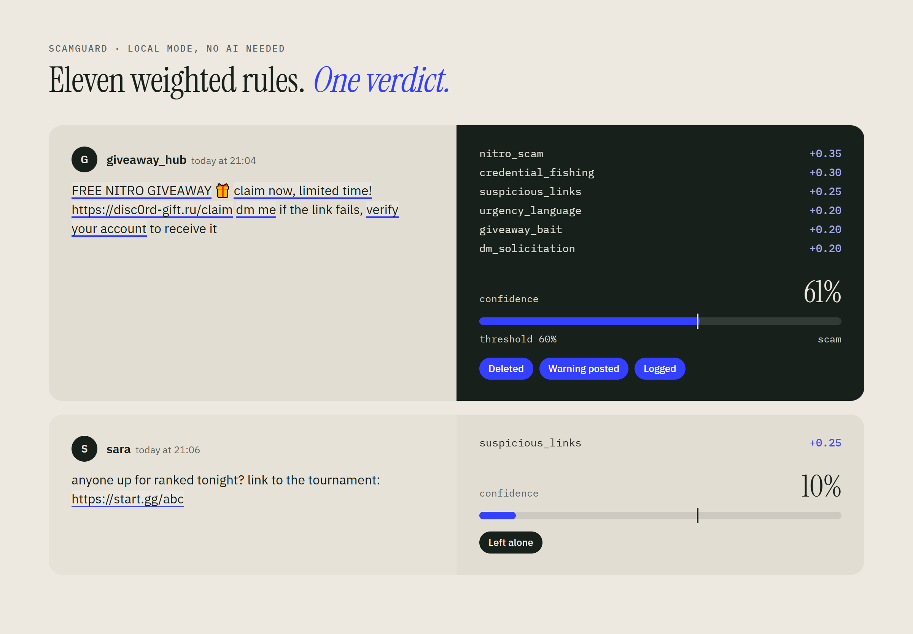

# ScamGuard

**A Discord bot that deletes scam messages and scam images the moment they're posted.**
Runs free with local rules, or sends the hard cases to an AI. [العربية](README.ar.md)



## How it decides

| | Local mode (default) | AI mode |
|---|---|---|
| **Text** | 11 weighted rules: fake Nitro, crypto bait, urgency, unknown links, "DM me", account phishing… | An LLM returns a verdict, a confidence and a reason |
| **Images** | Perceptual hash against known scam images in `scam_images/` | A vision model looks at the image |
| **Cost** | Free, nothing leaves your server | Per request |

When a message crosses the threshold, ScamGuard **deletes it**, **posts a warning** with the reason and confidence,
can **time the sender out**, and writes a structured JSON log. Drop new scam images into `scam_images/` and they apply
immediately, no restart.

## Run it

```bash
npm install
cp .env.example .env     # set DISCORD_TOKEN, optionally DETECTION_MODE=ai and AI_API_KEY
npm start
```

The bot needs **View Channels, Send Messages, Manage Messages** (and **Moderate Members** for timeouts), plus the
**Message Content** intent in the Developer Portal. Every setting is documented in `.env.example`.

## Code

```
src/index.js                    starts the client and wires everything up
src/detectors/localTextDetector the weighted rules
src/detectors/localImageDetector perceptual hashing (jimp)
src/detectors/ai*Detector       OpenAI or Anthropic, text and vision
src/handlers/                   message and image pipelines
src/utils/actionRunner.js       delete, warn, timeout
```

Node.js 18+, discord.js 14. MIT licence.
